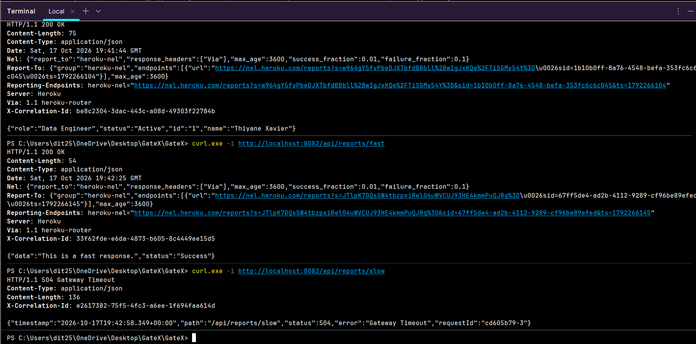
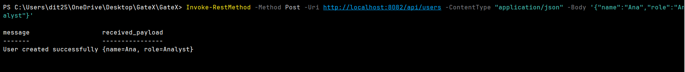

# GateX

A lightweight API gateway for microservices, built on Spring Cloud Gateway. It routes client requests to downstream services, injects a trace ID into every request, logs traffic, and enforces per-route timeouts.

**Stack:** Java 21, Spring Boot 3.3.4, Spring Cloud 2023.0.3, Spring Cloud Gateway, Actuator, Maven, Docker

## Features

| Requirement | What it does |
|-------------|--------------|
| FR-1 Routing | Forwards `/api/users/**` to UserService and `/api/reports/**` to ReportService. |
| FR-2 Logging | Gateway and Netty request logging, controlled in `application.yaml`. |
| FR-3 Trace ID | `CorrelationIdFilter` reuses the caller's `X-Correlation-Id` or generates one, forwards it downstream and returns it in the response. |
| Resiliency | The reports route has a 3 second connect and response timeout. A slower service gives the client a 504. |

## Routes

| Client path | Downstream | Notes |
|-------------|------------|-------|
| `/api/users/**` | UserService | `StripPrefix=1`, so `/api/users/1` reaches the service as `/users/1`. |
| `/api/reports/**` | ReportService | No prefix stripping. The service itself serves `/api/reports/...`. |

## Run locally

```
mvn spring-boot:run
```

GateX listens on port 8082 by default. The route targets are the deployed mock services on Heroku.

## Try it

Use `-i` to see response headers. On Windows PowerShell, use `curl.exe` instead of `curl`, because `curl` is an alias for a different command.

```
curl -i http://localhost:8082/api/users/1
curl -i http://localhost:8082/api/reports/fast
curl -i http://localhost:8082/api/reports/slow
```

Expected:

- `/api/users/1` returns the user JSON and an `X-Correlation-Id` header.
- `/api/reports/fast` returns 200.
- `/api/reports/slow` returns 504 after about 3 seconds, because the service takes 5.

### Example output

Requests sent through GateX to the deployed mock services. Every response carries its own `X-Correlation-Id`, and the slow route is cut off by the gateway with a 504 instead of waiting for the downstream service.



### Create a user (POST)

On PowerShell, `Invoke-RestMethod` avoids JSON quoting problems:

```
Invoke-RestMethod -Method Post -Uri http://localhost:8082/api/users -ContentType "application/json" -Body '{"name":"Ana","role":"Analyst"}'
```

On macOS or Linux:

```
curl -i -X POST http://localhost:8082/api/users -H "Content-Type: application/json" -d '{"name":"Ana","role":"Analyst"}'
```



### Trace propagation

Send your own ID and look for it in the response and in the UserService logs:

```
curl -i -H "X-Correlation-Id: demo-123" http://localhost:8082/api/users/1
```

## Deploy to Heroku (Docker)

Before deploying, set the port in `application.yaml` so Heroku can assign it:

```
server:
  port: ${PORT:8082}
```

Also lower the `TRACE` and `DEBUG` log levels to `INFO` for deployment, or the Heroku log stream will be flooded.

```
heroku login
heroku create your-gatex --stack container
git add .
git commit -m "Deploy GateX"
git push heroku master:main
```

Check it:

```
heroku logs --tail
curl -i https://your-gatex.herokuapp.com/api/users/1
```

## Notes

- The downstream services run on Heroku Eco dynos that sleep when idle. Wake them (call `/api/reports/fast` and `/api/users/1`) before running the timeout test. A cold start can take 10 to 30 seconds and will look like a gateway failure.
- Do not add the `PreserveHostHeader` filter. Heroku routes by Host header, so forwarding the gateway's host to a downstream Heroku app gives a 404.
- Keep secrets such as API keys in Heroku config vars (`heroku config:set`), not in the repo.
